<h1 align="center">Map Design</h1>

<p align="center"><b>Your coding agent can't draw a coastline. With this skill it doesn't have to.</b></p>

<p align="center">
An agent skill that turns "poster of Lisbon in azulejo blue" or "map this CSV by state"<br>
into a real, accurate map: one self-contained HTML page, an SVG and a print-ready PNG.<br>
Real borders, coastlines and coordinates. No API keys. No runtime dependencies.
</p>

<p align="center">
  <a href="https://github.com/incline-ltd/map-design/actions/workflows/ci.yml"></a>
  <a href="LICENSE"></a>
  
  
  <a href="https://agentskills.io"></a>
</p>

<p align="center">
  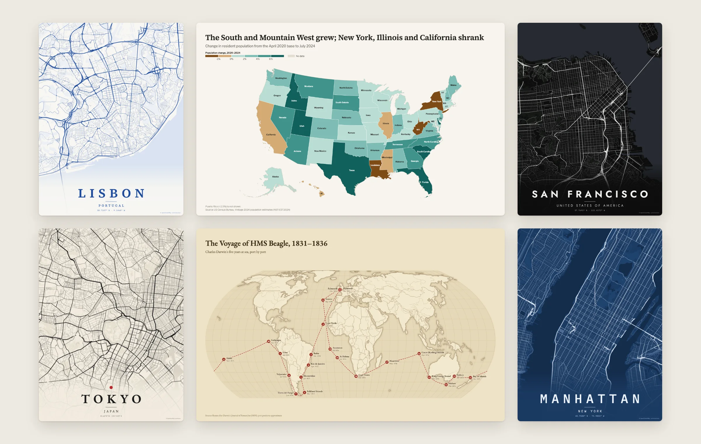
</p>

<p align="center"><code>npx skills add incline-ltd/map-design</code></p>

<p align="center">
  <a href="#ask-for-a-map">Ask for a map</a> ·
  <a href="#why-a-skill">Why a skill</a> ·
  <a href="#gallery">Gallery</a> ·
  <a href="#install">Install</a> ·
  <a href="#what-it-makes">What it makes</a> ·
  <a href="#how-it-works">How it works</a> ·
  <a href="#limits">Limits</a>
</p>

## Ask for a map

Once installed, ask your agent the way you would ask a designer:

- *"Make a poster of Lisbon in azulejo blue."*
- *"Map population change by US state from this Census CSV."*
- *"Where is Bhutan? Show it with a small globe."*
- *"Plot my trip: London, Dubai, Singapore, Sydney, Auckland, LA, New York, back to London."*
- *"Bubble map of our stores by revenue. The data is in stores.csv."*

The agent writes a short JSON spec, runs one command, looks at the PNG, fixes
what it sees, and hands you the files. Every place it resolved and every row it
could not match is listed, so nothing is silently guessed.

## Why a skill

A language model knows Lisbon sits on the Tagus. It does not know the shape of
the river, or where 11,237 streets run. Ask an agent for a map without help and
you get hand-drawn blobs, invented coordinates, or Leaflet boilerplate that
needs a tile server and an API key.

Map Design splits the work. The model decides what the map should say. The
renderer supplies real geography and cartography.

| Map | The agent writes | The renderer draws |
| --- | --- | --- |
| [Lisbon poster](examples/lisbon/spec.json) | a 93-byte spec | 1.6 MB of paths: 11,237 streets, the Tagus, 3,313 parks and green areas |
| [Tokyo poster](examples/tokyo/spec.json) | 89 bytes | 2.0 MB: 15,133 streets around the Imperial Palace |
| [US population change](examples/us-population-change/spec.json) | 661 bytes and a Census CSV | 50 states and DC, classed, labeled, with legend and source |
| [Voyage of HMS Beagle](examples/beagle-voyage/spec.json) | 22 stops | great-circle legs on an equal-area projection, numbered and dated |

Things a model gets wrong from memory and this skill gets right:

- **Joins.** "Korea, Rep.", "Côte d'Ivoire", "Türkiye", ISO codes, FIPS codes
  and World Bank names all match. Rows that do not match are listed with the
  closest names. Nothing is dropped quietly.
- **Ambiguous places.** "Lima" is also in Ohio and "Sydney" is also in Nova
  Scotia. The report says which one it used and how to be explicit.
- **Projections.** Equal-area by default (Equal Earth, Albers USA with Alaska
  and Hawaii, conic and azimuthal for regions). Antarctica is cropped from world
  maps unless the data goes there. No Mercator world maps.
- **Honest encodings.** Raw counts on a choropleth trigger a warning. Diverging
  palettes need a meaningful midpoint. Every map carries its source.

## Gallery

Every map below is real data, rendered by the skill from the spec it links to.

<table>
  <tr>
    <td width="33%">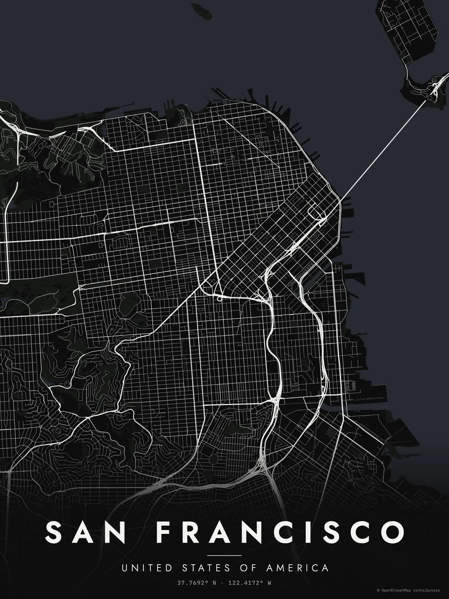</td>
    <td width="33%">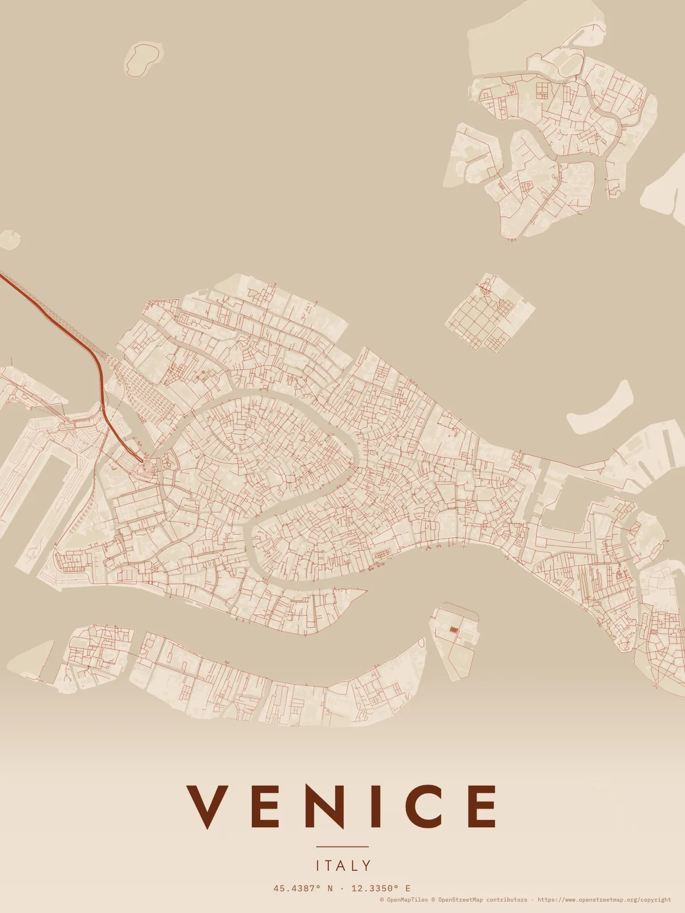</td>
    <td width="33%">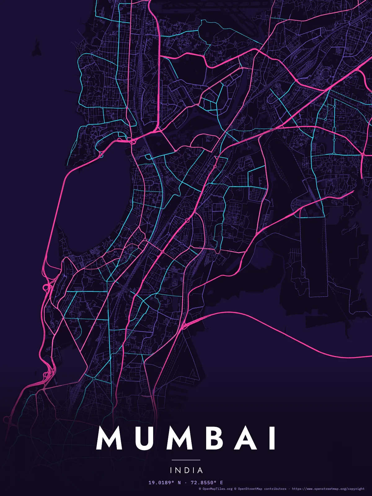</td>
  </tr>
  <tr>
    <td><sub><b>San Francisco</b> · <code>noir</code> · <a href="examples/san-francisco/spec.json">spec</a></sub></td>
    <td><sub><b>Venice</b> · <code>terracotta</code>. Few streets for cars, so it switched to footpaths · <a href="examples/venice/spec.json">spec</a></sub></td>
    <td><sub><b>Mumbai</b> · <code>neon</code> · <a href="examples/mumbai/spec.json">spec</a></sub></td>
  </tr>
  <tr>
    <td>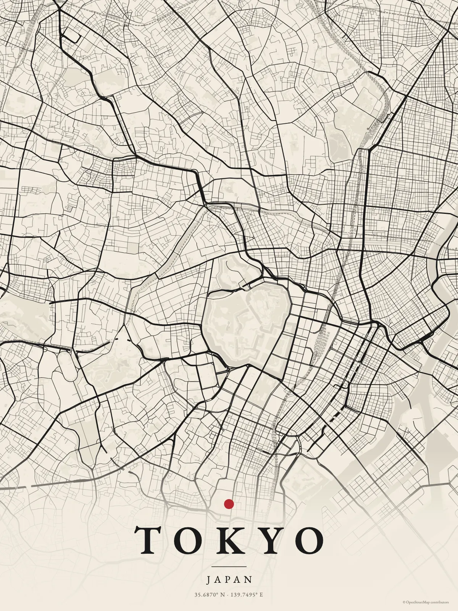</td>
    <td>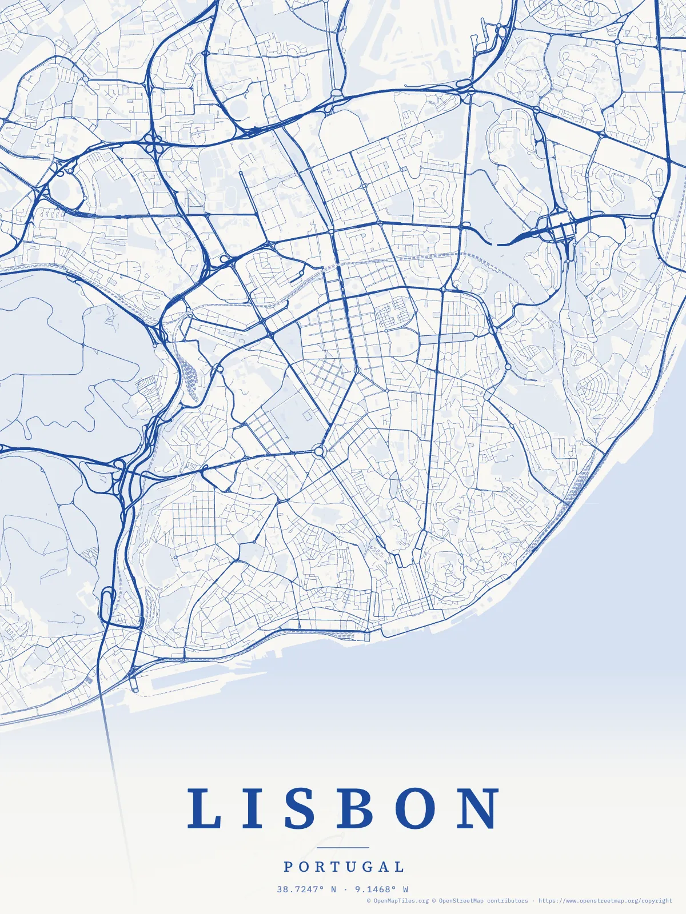</td>
    <td>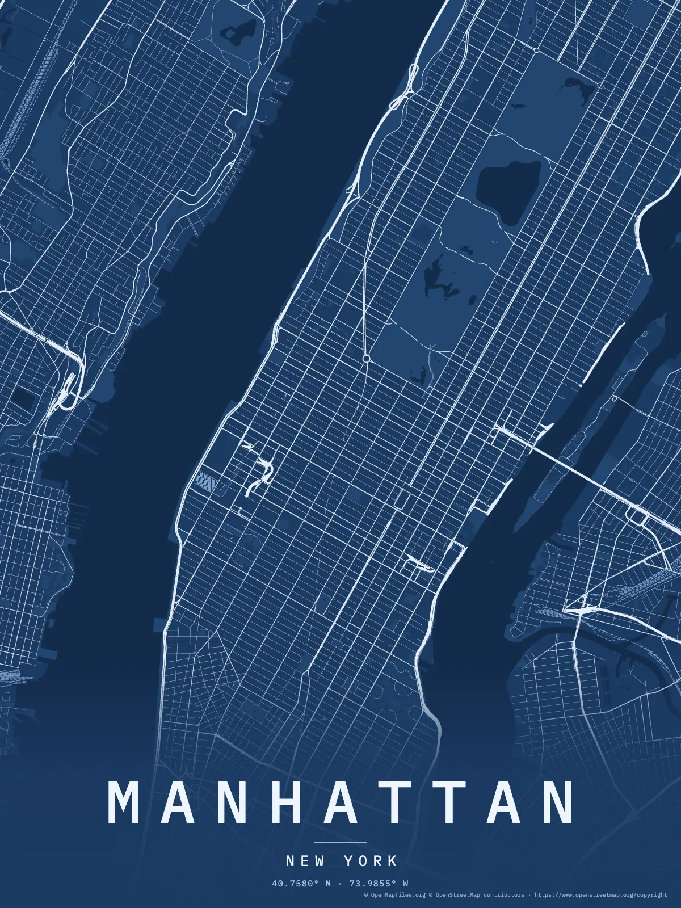</td>
  </tr>
  <tr>
    <td><sub><b>Tokyo</b> · <code>sumi</code> · <a href="examples/tokyo/spec.json">spec</a></sub></td>
    <td><sub><b>Lisbon</b> · <code>azulejo</code> · <a href="examples/lisbon/spec.json">spec</a></sub></td>
    <td><sub><b>Manhattan</b> · <code>blueprint</code> · <a href="examples/manhattan/spec.json">spec</a></sub></td>
  </tr>
</table>

<table>
  <tr>
    <td width="50%">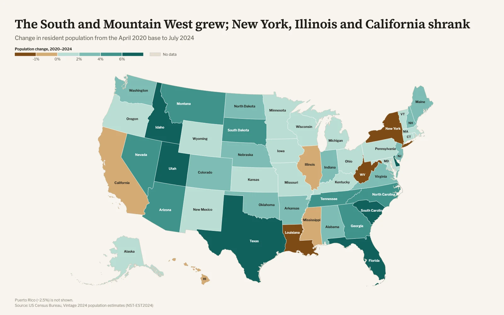</td>
    <td width="50%">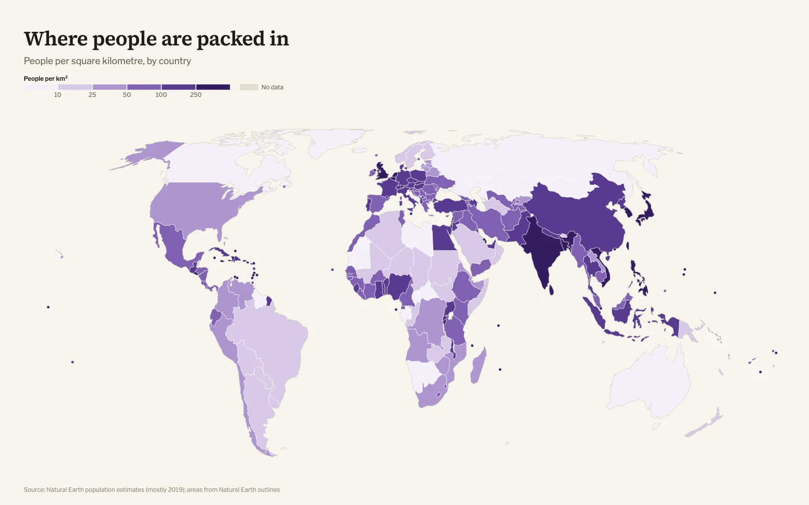</td>
  </tr>
  <tr>
    <td><sub><b>Choropleth</b> by US state, diverging around zero. US Census Bureau data · <a href="examples/us-population-change/spec.json">spec</a></sub></td>
    <td><sub><b>Choropleth</b> by country from the built-in table, no data file needed · <a href="examples/world-density/spec.json">spec</a></sub></td>
  </tr>
  <tr>
    <td>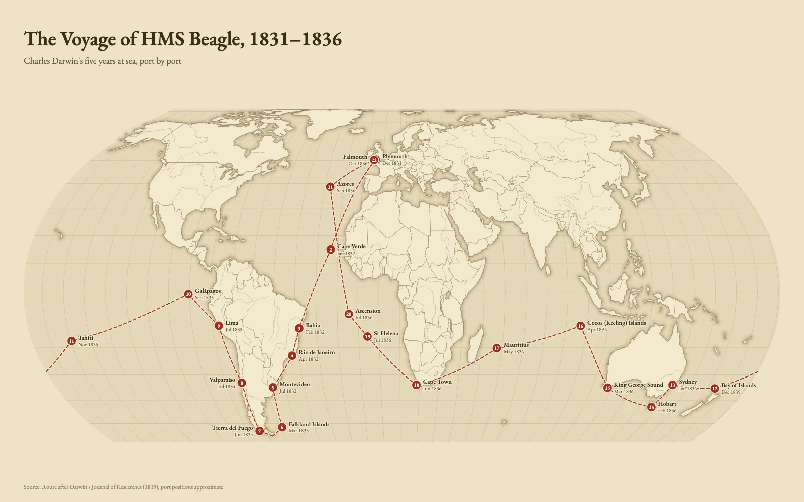</td>
    <td>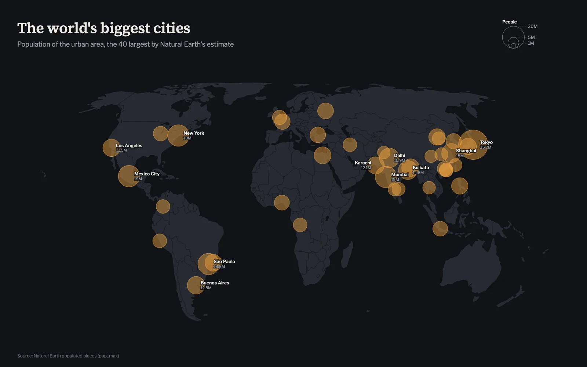</td>
  </tr>
  <tr>
    <td><sub><b>Route</b> · <code>antique</code>, numbered and dated stops · <a href="examples/beagle-voyage/spec.json">spec</a></sub></td>
    <td><sub><b>Bubbles</b> · <code>ink</code>, area proportional to population · <a href="examples/largest-cities/spec.json">spec</a></sub></td>
  </tr>
  <tr>
    <td>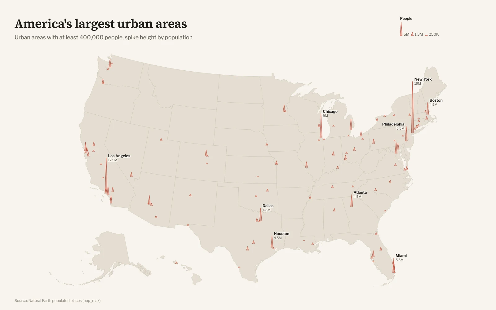</td>
    <td>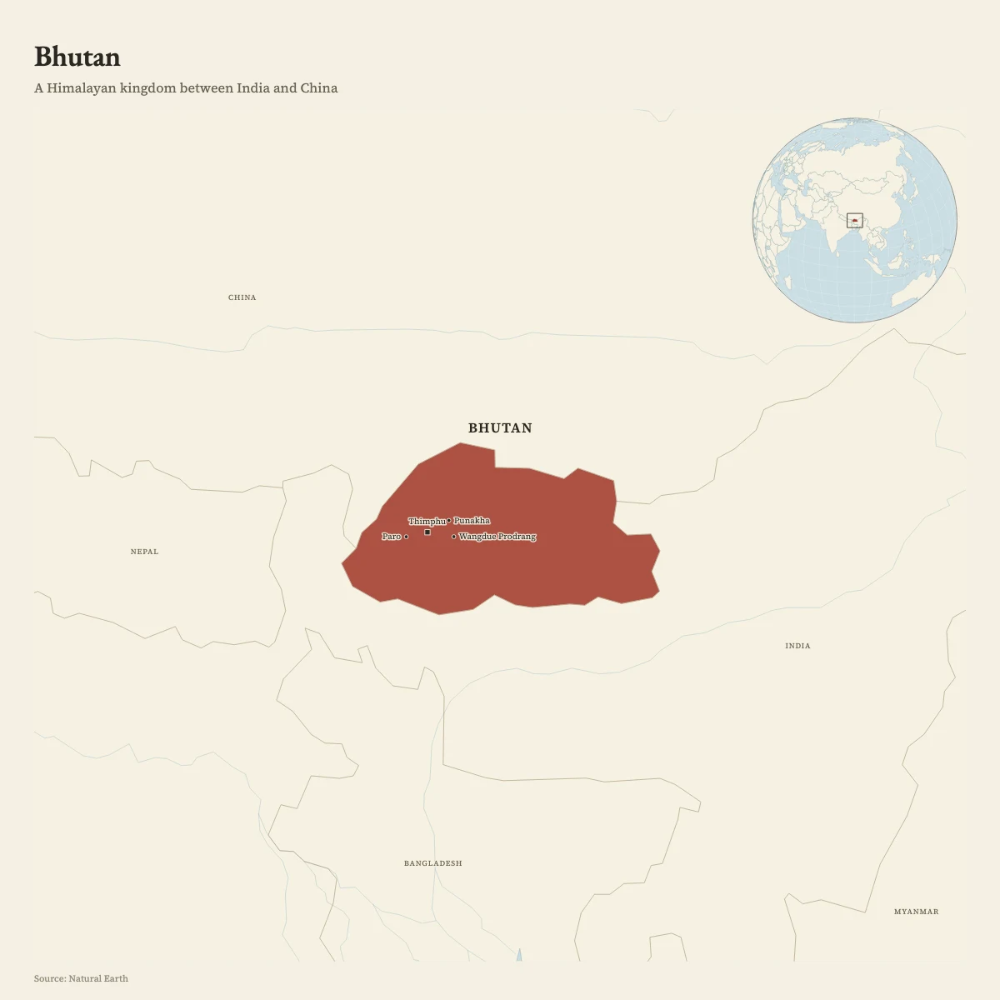</td>
  </tr>
  <tr>
    <td><sub><b>Spikes</b> on Albers USA · <a href="examples/us-cities/spec.json">spec</a></sub></td>
    <td><sub><b>Locator</b> · <code>atlas</code>, with cities and an inset globe · <a href="examples/where-is-bhutan/spec.json">spec</a></sub></td>
  </tr>
  <tr>
    <td>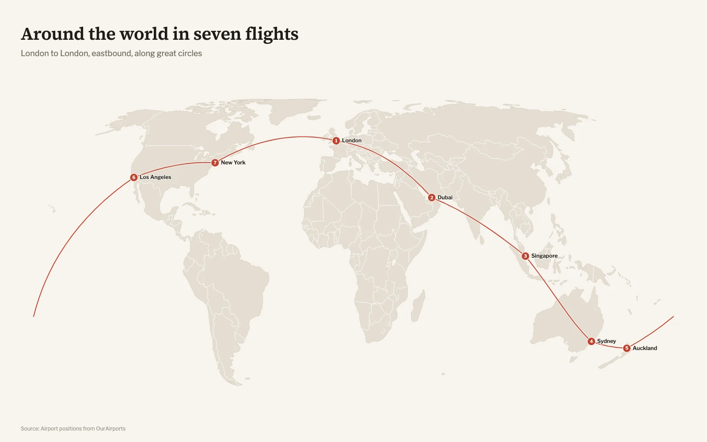</td>
    <td></td>
  </tr>
  <tr>
    <td><sub><b>Flights</b> along great circles from airport codes · <a href="examples/around-the-world/spec.json">spec</a></sub></td>
    <td></td>
  </tr>
</table>

## Install

Works with any agent that reads [Agent Skills](https://agentskills.io): Claude
Code, Codex, Cursor, Gemini CLI, GitHub Copilot, OpenCode and others.

```bash
npx skills add incline-ltd/map-design
```

In Claude Code you can also install it as a plugin:

```text
/plugin marketplace add incline-ltd/map-design
/plugin install map-design@map-design
```

Or copy `skills/map-design/` into your agent's skills folder, for example
`~/.claude/skills/map-design`.

Requirements: Node.js 20 or newer. PNG export uses a Chrome, Edge, Brave or
Chromium you already have; without one you still get HTML and SVG, and the
HTML page has a PNG button. City posters need an internet connection to fetch
OpenStreetMap data.

### Use it without an agent

The CLI is the same one the agent runs. Run these from the repository folder
(after `git clone https://github.com/incline-ltd/map-design.git && cd map-design`),
or use the full path to `map.mjs` from anywhere. `render` writes its files next
to the spec; `poster` writes them to the folder you run it in.

```bash
node skills/map-design/scripts/map.mjs render examples/world-density/spec.json
node skills/map-design/scripts/map.mjs poster --place "Kyoto" --country JPN --theme sumi --radius 3
node skills/map-design/scripts/map.mjs find "Springfield"
node skills/map-design/scripts/map.mjs themes
```

## What it makes

| Kind | For | Example spec |
| --- | --- | --- |
| `choropleth` | Rates by country, by state or province (251 countries and territories), by US state or US county | [US population change](examples/us-population-change/spec.json) |
| `bubbles` | Totals at places, circle area ∝ value | [Largest cities](examples/largest-cities/spec.json) |
| `spikes` | Many values at points, height ∝ value | [US urban areas](examples/us-cities/spec.json) |
| `points` | Locations, colored by category | [spec reference](skills/map-design/references/spec.md#points) |
| `route` | Trips, voyages, itineraries, flights by airport code | [HMS Beagle](examples/beagle-voyage/spec.json) |
| `flows` | Movement with volume: migration, trade, traffic | [spec reference](skills/map-design/references/spec.md#flows) |
| `locator` | "Where is it?" with context and an inset globe | [Bhutan](examples/where-is-bhutan/spec.json) |
| `poster` | Any city's streets as print art, from OpenStreetMap | [Lisbon](examples/lisbon/spec.json) |

**Themes for data maps:** `paper` (default), `atlas`, `ink`, `antique`, `swiss`, `blueprint`.
**Themes for posters:** `noir`, `paper`, `mono`, `blueprint`, `sumi`, `terracotta`, `azulejo`, `neon`, `forest`.

Every map is one SVG with its fonts embedded, so it looks the same in a
browser, a slide or a print shop. The HTML adds hover tooltips, zoom and pan,
and SVG and PNG download buttons. It makes no network requests.

A spec is short:

```json
{
  "kind": "choropleth",
  "region": "usa",
  "title": "The South and Mountain West grew; New York, Illinois and California shrank",
  "data": "states.csv",
  "join": "fips",
  "value": "change",
  "scale": { "type": "threshold", "breaks": [-1, 0, 2, 4, 6], "palette": "brown-teal", "center": 0 },
  "format": { "suffix": "%" },
  "source": "US Census Bureau, Vintage 2024 population estimates"
}
```

Full reference: [spec.md](skills/map-design/references/spec.md).
Design guidance the agent follows: [cartography.md](skills/map-design/references/cartography.md).

## How it works

1. **Resolve.** Every location in the spec is looked up in bundled data:
   7,342 cities and towns, 3,244 airports, 242 countries, first-level regions
   for 251 countries and territories, and every US state and county. Ambiguities and misses go
   into the report.
2. **Join and classify.** Rows join to boundaries by code or name. Values are
   classed by quantiles, natural breaks, thresholds or a continuous ramp, with
   perceptually even palettes.
3. **Project.** The renderer picks an equal-area projection that suits the
   region, or uses the one you name.
4. **Draw.** Base map, data, borders, symbols, labels placed without overlaps,
   then the title, legend and source. Only the font faces and character sets
   the map uses are embedded.
5. **Export.** HTML, SVG and PNG (2×, or 3× for posters: 3600×4800 px, 12×16 in
   at 300 dpi).

Posters fetch streets, water, parks, rail and coastline from the public
Overpass API in one query, cache them, and rebuild the sea from OpenStreetMap
coastlines. Car-free centers such as Venice automatically get footpaths.

The skill is about 9 MB: 8 MB of simplified open data, 0.8 MB of fonts and the
renderer. Everything except poster downloads works offline.

## Limits

- **Borders** follow Natural Earth's de facto view. Disputed areas are drawn the
  way Natural Earth draws them, which does not match every government's official
  position. See [cartography.md](skills/map-design/references/cartography.md#borders-and-names).
- **Small places** outside the gazetteer need `lon`/`lat`.
- **Posters** depend on the public Overpass API, which is sometimes at capacity.
  The CLI backs off and retries, and caches every download.
- **Labels** are placed greedily. On dense maps some are left out; the report
  lists them.
- **No tiles or imagery.** These are vector maps, not slippy maps. No road
  routing, terrain shading or your own boundary files yet.
- **Statistics in `builtin:countries`** are Natural Earth's 2019 estimates. For
  current figures, give the agent a source to fetch.

## Contributing

Bug reports with the spec and the PNG are the most useful thing you can send.
New themes, label placement improvements and gallery examples built on open,
cited data are welcome. See [CONTRIBUTING.md](CONTRIBUTING.md).

## License

MIT for the code. Bundled data is public domain (Natural Earth, US Census
Bureau, OurAirports). Fonts are under the SIL Open Font License. Posters
contain OpenStreetMap data, © OpenStreetMap contributors (ODbL). Details:
[THIRD_PARTY_NOTICES.md](THIRD_PARTY_NOTICES.md).
